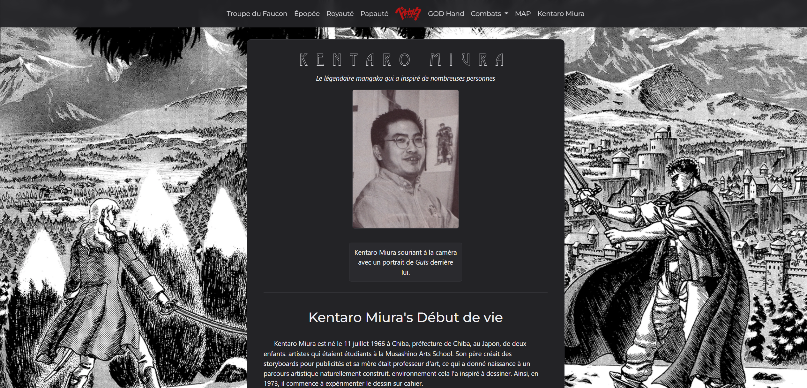

## Berserk — Guts, son épopée et ses aventures

Ce dépôt rassemble une carte interactive et des pages thématiques pour naviguer dans l'univers de "Berserk" (œuvre de Kentaro Miura). Le contenu est principalement statique et prévu pour être servi depuis GitHub Pages ou un serveur HTTP simple.



### Accès en ligne

Voir la page principale hébergée : [Berserk Story](https://bastienlopez.github.io/Berserk/templates/Kentaro_Miura.html)

### Fonctionnalités

- Carte interactive des lieux et événements
- Chronologie et pages descriptives pour personnages et arcs
- Assets (images, styles, scripts) organisés dans `img/`, `style/`, `js/`

### Aperçu local rapide

1. Depuis la racine du projet, lance un serveur HTTP léger :

```powershell
# Avec Python 3
py -3 -m http.server 8000
# Puis ouvre http://localhost:8000/templates/Kentaro_Miura.html
```

2. Ou utilise l'extension "Live Server" de VS Code pour ouvrir `templates/Kentaro_Miura.html`.